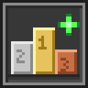
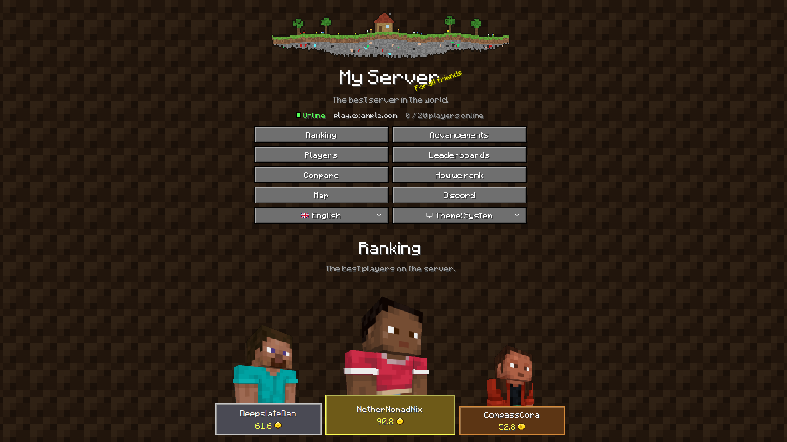

<h1> Stats WebUI Plus</h1>

**Live competitive rankings for your Minecraft survival server.**

A **Fabric and NeoForge server mod** that embeds a small web UI + API. Players open it in a browser — no client mod needed.

Stats WebUI Plus is a fork of **[mc-stats-webui](https://github.com/borrageiros/mc-stats-webui) by borrageiros**, who created the mod, its web UI and the ranking system. This fork is maintained by **NR137** and adds NeoForge support, German, configurable branding, first join / last online times and more; see the [changelog](CHANGELOG.md) for everything that differs from mc-stats-webui 1.2.1.

> [!NOTE]
> **Written with AI.** Most of this fork's code, texts and docs were written by an AI coding assistant (Claude by Anthropic), directed and partly tested by NR137. Not every feature has been tested in depth, so some things may not work as expected. This note is about the fork only; the original mc-stats-webui by borrageiros is a separate project.



**[More screenshots](screenshots/README.md):** every page, the light theme, all four languages and the mobile layout.

## ✨ Features

- 🏆 Home podium with **Champion**, **Most dedicated**, and **Most efficient** crowns
- 🥇 Vanilla advancements: who has the most, who unlocked a specific one, and a player’s full list, plus a progress bar with tiers from Stone to Netherite (and Dragon Egg at 100 %)
- 🆚 Side-by-side player compare
- 🕒 First join and last online time per player, shown in each visitor's own time zone (recorded by the mod; estimated for players from before it was installed)
- 📊 Leaderboards for the whole vanilla stats catalog (custom, mined, killed, …)
- 🧮 Transparent scoring (“How we rank”) — farms inflate some boards on purpose
- 🌐 UI in **English / Español / Français / Deutsch**, with Minecraft's official block, item, mob and advancement names (picked from the browser's preferred languages, falling back to `defaultLanguage` in the config, default `en`) · light / dark / system theme
- 🏷️ Branding: a header image (a pixel-art banner ships as the default), site heading with a Minecraft-style splash tagline and slogan, window title, extra menu links such as Map or Discord (see Configuration below)
- 🧍 3D player avatars with the players' skins; players without a skin of their own (e.g. on offline-mode servers) get the Minecraft default skin the game shows them
- ⚡ In-memory stats cache (see below)

## ⚙️ Configuration

Settings live in `config/stats_webui_plus.json` on the server. The file is created with defaults on first start. Changes apply as soon as the file is saved, no restart needed; if they don't (some network drives don't report changes), run `/reload`. Only a new `world` waits for a restart. A file that can't be read is reported in the server log and the previous settings stay. Open pages show the changes after a reload. Missing settings are filled in with their defaults. Config files of the original mc-stats-webui (`config/mc-stats-webui*.json`) are not read.

| Setting | Default | What |
| --- | --- | --- |
| `port` | `25580` | Port of the web UI and API |
| `bind` | `"0.0.0.0"` | Address to listen on; `"127.0.0.1"` for local only (e.g. behind a reverse proxy) |
| `world` | `""` | World folder to read stats from, relative to the server folder; `""` = the running world |
| `windowTitle` | `"{page} - My Server"` per language | Browser tab title; text per language or one text for all; each must contain `{page}` (the page name) |
| `refreshCooldownMs` | `15000` | Cache reuse window in ms, see Stats cache below; `0`–`60000` |
| `saveIntervalSeconds` | `0` | Also saves online players' stats and advancements this often, so a server crash loses less; `0` leaves it to Minecraft (every 5 minutes and on logout); `0`–`3600` |
| `defaultLanguage` | `"en"` | UI language for visitors whose browser languages are all unsupported (or disabled) |
| `languages` | `["de", "en", "es", "fr"]` | Languages offered in the UI; e.g. `["de", "en"]`. With a single language the language switcher is hidden |
| `headerImage` | `"stats_webui_plus/header.png"` | Header image, relative to the `config/` folder; `""` turns it off |
| `headerImagePosition` | `"top"` | Where the header image goes: `"top"` (above the site heading), `"between"` (between the site heading and the slogan) or `"bottom"` (below the slogan) |
| `siteHeading` | `"My Server"` per language | Heading under the header image on every page; text per language (`{"en": "My Server", "de": "Mein Server"}`) or one text for all; empty turns it off (and its tagline and slogan) |
| `siteHeadingTagline` | `"For all friends"` per language | Small rotated text next to the site heading; text per language or one text for all; `""` hides it |
| `siteHeadingTaglinePulse` | `true` | Whether the tagline pulses in size like Minecraft's splash text (never for visitors whose system asks for reduced motion) |
| `siteHeadingSlogan` | `"The best server in the world."` per language | Line under the site heading; text per language or one text for all; `""` hides it |
| `statusBar` | `true` | Status bar under the site heading: online indicator, server address and current player count (refreshed every 30 s) |
| `serverAddress` | `""` | Address players connect to (e.g. `"mc.example.com"`), shown in the status bar; click to copy. `""` hides it |
| `avatarPose` | `"walk"` | Starting pose of the 3D avatar on player pages: `"idle"`, `"walk"`, `"run"` or `"fly"` |
| `avatarAngle` | `0` | Starting camera angle around that avatar in degrees: `0` = facing you, `30` = slightly turned, `90` = side, `180` = back |
| `avatarRotate` | `true` | Whether that avatar slowly turns on its own when the page opens; visitors can switch it with the rotate button |
| `links` | Map, Discord and Dashboard placeholders | Extra menu buttons, see below |

**Headings:** the site heading is each page's main heading (`<h1>`); page titles below it (Ranking, Players, …) are `<h2>`. Without a site heading, the page titles are the `<h1>`. They look the same either way.

### 🔗 Menu links

`links` adds buttons to the menu, after the normal entries and before the language/theme switchers. Three placeholders are preconfigured; a button only appears once its `url` is filled in:

```json
"links": [
  { "label": { "en": "Map", "de": "Karte", "es": "Mapa", "fr": "Carte" }, "url": "https://map.example.com", "newTab": true },
  { "label": { "en": "Discord", "de": "Discord", "es": "Discord", "fr": "Discord" }, "url": "", "newTab": true },
  { "label": { "en": "Dashboard", "de": "Dashboard", "es": "Panel", "fr": "Tableau de bord" }, "url": "", "newTab": true }
]
```

- `label`: plain text, or text per language (falls back to English, then the first one given).
- `url`: must start with `http://`, `https://` or a single `/` (a page on this site, e.g. `/map`); anything else, including `//host`, is ignored with a warning in the server log.
- `newTab`: open in a new browser tab (default `true`).
- Add as many entries as you like; `"links": []` removes the placeholders for good.

### 🖼️ Header image

The mod ships a pixel-art banner (a floating island) and puts it at **`config/stats_webui_plus/header.png`** on first start, next to the new default config. Replace that file with your own image, or set `headerImage` to `""` to hide it without deleting it; a deleted file is not written again. The image appears at the top of every page, above the site heading; `headerImagePosition` can put it between the site heading and the slogan (`"between"`) or below the slogan (`"bottom"`). If the file is missing, no header is shown. To use another name or format, set `headerImage` to a path inside `config/`, e.g. `"mc_stats_webui/banner.webp"`. Supported: `.png`, `.jpg`/`.jpeg`, `.webp`, `.gif` (animated works).

**Recommended: 240 px high (120 px for the page, twice that for high-DPI screens), e.g. 1200 × 240 px.**

- The image is shown in a box of at most **832 × 120 px** (CSS pixels) on desktop and a little lower on phones, whatever the file's resolution: a larger file only looks sharper.
- Images are only ever scaled **down**, never up, keeping their proportions. Anything lower than 120 px shows smaller than the box.
- A narrow image (e.g. 2 : 1) is limited by the height and appears smaller and centred; a very wide one (wider than 7 : 1) is limited by the width and appears flatter.
- Pixel art: export it so one art pixel is a whole number of file pixels at 240 px height (the shipped banner is 40 art pixels high, 6 file pixels each).

Replacing the file shows the new image on the next page load; no restart needed.

## 🧠 Stats cache

On world start the mod loads every player stats file into RAM. The API serves that snapshot — it does not re-scan the disk on each request.

When a player's stats or advancements change, they are marked dirty. Nothing else happens until the web UI asks: an API request then has the server thread copy the dirty online players' stats out of memory (advancement progress only if it changed), which takes a fraction of a millisecond, and turns the copies into players and ranks them on the request's own thread. Nothing is saved or read from disk for online players; players who went offline are read from the files Minecraft saved on logout. While nobody opens the web UI, the mod costs the server thread nothing.

API requests within `refreshCooldownMs` (default `15000`, 15 seconds) of the last refresh reuse the cache without touching the server thread, so the game does that work at most once per window however many people browse the site, and stats on the page are at most that old. Set it to `0` to refresh on every request.

API responses tell browsers and proxies (e.g. a Cloudflare cache rule for `/api/*`) to keep them until the next refresh is due (`Cache-Control: max-age` = the time left in the current `refreshCooldownMs` window), so cached copies never outlive the stats behind them. `/api/health`, errors and `refreshCooldownMs = 0` are never cached.

Player skins are fetched from Mojang through `/mojang/...`, because browsers may not load them from Mojang directly. The mod keeps skin images in memory (a skin's URL never changes; a new skin gets a new one) and player profiles for 5 minutes, so a skin change shows up on the site within 5 minutes and Mojang's rate limit is rarely touched.

| URL | What |
| --- | --- |
| `http://localhost:25580/` | Web UI |
| `http://localhost:25580/api/players` | JSON API |

## 🛠️ Development

**Needs:** [Docker](https://docs.docker.com/get-docker/) (with Compose) · Minecraft 26.3 to play on the dev server

Everything else runs in one dev image (`docker/Dockerfile`): Java, Node and Python in the versions of [`.tool-versions`](.tool-versions) (the only place they are set), Yarn from `web/package.json`, Playwright and Chromium from `scripts/requirements.txt`, Gradle from its wrapper. [`compose.yaml`](compose.yaml) runs it with your checkout mounted and the Gradle and Yarn caches in volumes. After changing `.tool-versions` or `scripts/requirements.txt`, run `docker compose build`.

**VS Code:** open the folder and run **Dev Containers: Reopen in Container** (extension *Dev Containers*). Terminal, Gradle, Java and Svelte tooling then run in the container, the commands below work without `docker compose run --rm dev`, ports are forwarded, and the pre-commit hook is turned on.

The build and test commands live in [`docker/tasks.sh`](docker/tasks.sh):

```bash
docker compose run --rm dev docker/tasks.sh build      # JARs in fabric/build/libs/ and neoforge/build/libs/
docker compose run --rm dev docker/tasks.sh test       # Java and web tests
docker compose run --rm dev docker/tasks.sh all        # everything CI runs (tests, build, game tests, smoke tests)
docker compose run --rm dev                            # a shell in the dev image
```

Dev server and web UI with hot reload:

```bash
docker compose up server               # Fabric dev server (fabric/runs/server/); LOADER=neoforge docker compose up server
docker compose up web                  # web UI on http://localhost:5173, /api and /mojang go to the dev server
```

Connect with Minecraft to `localhost:25565`; the mod's web UI is on `http://localhost:25580`. The first start of a dev server stops until you accept Mojang's EULA in `<loader>/runs/server/eula.txt`.

Minecraft textures and minecraft.wiki inventory icons are downloaded once per Minecraft version into `scripts/.cache/`. To fetch them again (e.g. after the wiki updated icons), run `./gradlew build -PrefreshTextures` (in the dev image). Icons the wiki refuses during that burst of downloads are retried on the next build.

The SvelteKit UI is built static and shipped **inside both JARs**.

**Scripts** (texture extraction, the banner and icon, sample players and screenshots): see [`scripts/README.md`](scripts/README.md), including how to take the screenshots again.

### Tests

| Task | What |
| --- | --- |
| `test-java` | JUnit tests of `common/` (`common/src/test`): config, ranking, session log, names, stats and API data, web server, Mojang proxy against a fake Mojang |
| `test-web` | Type check and Vitest tests of the web UI (`web/src/**/*.test.ts`) |
| `gametest` | A mock player on each loader's game test server: joining and leaving, stats and advancements reaching the stats cache through the mixins (`common/src/gametest`, registered in `fabric/src/gametest` and `neoforge/src/gametest`) |
| `smoke` | The built JARs on the official Fabric and NeoForge servers with sample players, checked over HTTP and in headless Chromium (needs `build` first; see [`scripts/README.md`](scripts/README.md#smoke-test)) |

Run one with `docker compose run --rm dev docker/tasks.sh <task>`. The `tests` workflow (`.github/workflows/tests.yml`) runs all of them in the same image on every pull request and push to `main`, and before every release.

A pre-commit hook runs the Java or web tests a commit touches, in the dev container or through Docker. The dev container turns it on; in another clone, run `git config core.hooksPath .githooks` once. `git commit --no-verify` skips it.

### Releasing

The `release` workflow (`.github/workflows/release.yml`) only runs when started by hand: **Actions → release → Run workflow**, or `gh workflow run release.yml`. Nothing starts it automatically. It runs the tests first; if one fails, nothing is built or released.

1. Set `mod_version` in `gradle.properties` and give its `CHANGELOG.md` section a date (`## [1.3.0] - 2026-10-30`).
2. Run the workflow without "draft release" to only build: the two JARs and the release notes are attached to the run for a day.
3. Run it with "draft release" to create a draft GitHub release `v<mod_version>+<minecraft_version>` with both JARs and that version's `CHANGELOG.md` section as notes. Drafts are invisible to others and create no tag; check it, then publish it on GitHub.

The workflow caches Gradle, Yarn and the texture downloads (`scripts/.cache`) between runs.

### Project layout

One codebase builds both loaders (based on [MultiLoader-Template](https://github.com/jaredlll08/MultiLoader-Template)):

| Folder | What |
| --- | --- |
| `common/` | Everything shared: web server, API, stats cache, config, mixins. Compiled against plain Minecraft, so it cannot use Fabric or NeoForge APIs. |
| `fabric/` | Fabric entry point (lifecycle/tick events), `FabricPlatform`, `fabric.mod.json` |
| `neoforge/` | NeoForge entry point (lifecycle/tick events), `NeoForgePlatform`, `neoforge.mods.toml` |
| `build-logic/` | Gradle scripts shared by the three projects |
| `docker/`, `compose.yaml`, `.devcontainer/` | The dev image, its tasks and the VS Code dev container |
| `web/` | Web UI (SvelteKit) |
| `scripts/` | Minecraft texture extraction, default banner and mod icon, sample players and screenshots ([README](scripts/README.md)) |

Loader-specific needs (config/game folder, versions) go through the small `Platform` interface in `common/`; each loader passes its implementation to `McStatsWebui.init` at startup.

## 📄 License and credits

MIT License, see [LICENSE](LICENSE). Original mod: [mc-stats-webui](https://github.com/borrageiros/mc-stats-webui) © borrageiros. Fork: Stats WebUI Plus © NR137.
