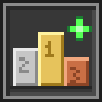
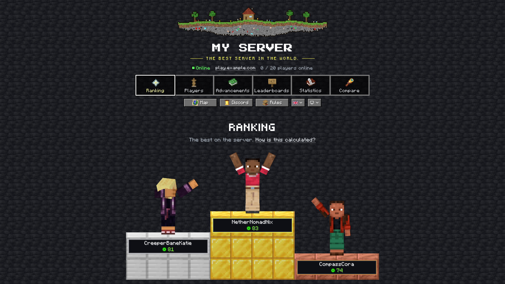

<h1> Stats WebUI Plus</h1>

**Your Minecraft server's rankings, statistics and advancements on a website.**

A **Fabric and NeoForge server mod** that embeds a small web UI + API. Players open it in a browser — no client mod needed.

**NOT AN OFFICIAL MINECRAFT PRODUCT. NOT APPROVED BY OR ASSOCIATED WITH MOJANG OR MICROSOFT.**

Stats WebUI Plus by **NR137** was inspired by **[mc-stats-webui](https://github.com/borrageiros/mc-stats-webui) by borrageiros**, whose idea of a website with the rankings of a Minecraft server started it. It is written from scratch.

> [!NOTE]
> **Written with AI.** Most of this project's code, texts and docs were written by an AI coding assistant (Claude by Anthropic), directed and partly tested by NR137. Not every feature has been tested in depth, so some things may not work as expected.



**[More screenshots](screenshots/README.md):** every page, the light theme, all four languages and the mobile layout.

## ✨ Features

- 🏆 A ranking by **level**: seven skills (Milestones, Combat, Exploration, Mining, Building, Farming, Survival), each counting how many different things a player did and how much, so farms and AFK time can't buy the top; every skill has its own leaderboard, and the ranking page ranks players three ways: **Legends** (level), **Veterans** (play time) and **Grinders** (actions per hour)
- 🥇 Vanilla advancements on the game's frames: who has the most, who unlocked a specific one, and a player’s full list, plus a progress bar with tiers from Stone to Netherite (and Dragon Egg at 100 %)
- 🌳 Advancements as tiles or as the game's own tree (its layout, backgrounds and lines), on a player's page and the overview
- 🧭 A player's page per advancement: when it was done, and for advancements with several parts (every biome, every mob, a balanced diet, …) which parts are done, when, and which are still missing
- 🆚 Two players compared row by row: skills, leaderboards, statistics and the advancements only one of them has
- 🕒 First join and last online time per player, shown in each visitor's own time zone (recorded by the mod; estimated for players from before it was installed)
- 📊 Leaderboards for the whole vanilla stats catalog (custom, mined, killed, …), on a Statistics page with the game's groups as tabs
- 🧮 Transparent scoring (“How we rank” explains every number; each player page shows what their skills are made of) — farms still show on their own boards
- 🧱 The game's own look: every block, item and mob as an icon, biomes as small scenes, animated where the game animates, all drawn by the mod from Minecraft's textures, which it downloads from Mojang (see Game textures and icons below)
- 🌐 UI in **English / Español / Français / Deutsch**, with Minecraft's official block, item, mob and advancement names (picked from the browser's preferred languages, falling back to `defaultLanguage` in the config, default `en`) · two themes, Birch (light) and Deepslate (dark), or the system's choice
- 🎮 The menu as the game's hotbar: each page a slot with its item icon, the current one framed like the selected slot, and a small hotbar that stays on top while scrolling
- 🏠 A start page of your own, and pages and links as entries of the menu with a game item as their icon
- 🏷️ Branding: a header image (a pixel-art banner ships as the default), the site heading in one of two fonts (or your own) with a slogan in one of five looks, page titles in one of three fonts, window title, your own favicon, extra menu links such as Map or Discord, and pages of your own such as an imprint, a privacy policy or the server rules, written in Markdown, HTML or plain text (see Configuration below)
- 📎 Link previews: a link to the website shared on Discord, WhatsApp and the like shows a card with the heading, slogan and header image; a player's page shows the player and their level
- 🧍 3D player avatars with the players' skins; players without a skin of their own (e.g. on offline-mode servers) get the Minecraft default skin the game shows them
- 🪨 Floodgate (Geyser) support: Bedrock players show their own skin and name (from GeyserMC's Global API), and players Floodgate gave the same name are told apart
- ⚡ Light on the server: the stats are kept in memory and refreshed at most once per `refreshCooldownMs` (see Stats in memory below)

## ⚙️ Configuration

Settings live in `config/stats_webui_plus.json` on the server. The file is created with defaults on first start. Changes apply as soon as the file is saved, no restart needed; if they don't (some network drives don't report changes), run `/reload`. Only a new `world` waits for a restart. A file that can't be read is reported in the server log and the previous settings stay. Open pages show the changes after a reload. Missing settings are filled in with their defaults.

| Setting | Default | What |
| --- | --- | --- |
| `port` | `25580` | Port of the web UI and API |
| `bind` | `"0.0.0.0"` | Address to listen on; `"127.0.0.1"` for local only (e.g. behind a reverse proxy) |
| `world` | `""` | World folder to read stats from, relative to the server folder; `""` = the running world |
| `windowTitle` | `"{page} - My Server"` per language | Browser tab title; text per language or one text for all; each must contain `{page}` (the page name) |
| `refreshCooldownMs` | `15000` | Cache reuse window in ms, see Stats in memory below; `0`–`60000` |
| `saveIntervalSeconds` | `0` | Also saves online players' stats and advancements this often, so a server crash loses less; `0` leaves it to Minecraft (every 5 minutes and on logout); `0`–`3600` |
| `webThreads` | `0` | Threads answering web requests; `0` = automatic: half the server's CPUs (a container's limit counts), at least 1 and at most 4, so the game keeps the rest. Even 1 thread answered about 900 requests per second in the load test; `0`–`16` |
| `defaultLanguage` | `"en"` | UI language for visitors whose browser languages are all unsupported (or disabled) |
| `languages` | `["de", "en", "es", "fr"]` | Languages offered in the UI; e.g. `["de", "en"]`. With a single language the language switcher is hidden |
| `headerImage` | `"stats_webui_plus/header.png"` | Header image, relative to the `config/` folder; `""` turns it off |
| `headerImagePosition` | `"top"` | Where the header image goes: `"top"` (above the site heading), `"between"` (between the site heading and the slogan) or `"bottom"` (below the slogan) |
| `favicon` | `""` | The browser tab's icon, a `.png`, `.ico`, `.svg`, `.webp` or `.gif` file relative to the `config/` folder; `""` uses the Minecraft server's own icon (`server-icon.png`), or the mod's without one. See Favicon and link previews below |
| `siteHeading` | `"My Server"` per language | Heading under the header image on every page; text per language (`{"en": "My Server", "de": "Mein Server"}`) or one text for all; empty turns it off (and its slogan) |
| `siteHeadingSlogan` | `"The best server in the world."` per language | Line under the site heading; text per language or one text for all; `""` hides it |
| `startPage` | `""` | The id of one of your `pages` to use as the start page (see Custom pages below); `""` keeps the ranking |
| `siteHeadingFont` | `"blocky"` | The site heading's font: `blocky` (Press Start 2P, in capitals), `gothic` (Jacquard 12, a pixel blackletter, as written) or `custom` (your own, see Custom font below) |
| `siteHeadingCustomFont` | empty | Your own font for the site heading, used with `"siteHeadingFont": "custom"`: `{"name": ..., "files": [...], "license": ..., "licenseFile": ...}`, see Custom font below |
| `siteHeadingSloganStyle` | `"line"` | How the slogan is shown: `line` (spaced capitals in gold between two lines), `plate` (on a plate), `above` (small, above the heading), `ribbon` (on a ribbon) or `quote` (in quotes, italic) |
| `pageTitleFont` | `"tiny"` | The page titles' font: `tiny` (Tiny5, in capitals), `blocky` (Press Start 2P, in capitals) or `minecraft` (the Minecraft font of the rest of the page); a player's name stays in the Minecraft font |
| `statusBar` | `true` | Status bar under the site heading: online indicator, server address and current player count (refreshed every 30 s) |
| `serverAddress` | `""` | Address players connect to (e.g. `"mc.example.com"`), shown in the status bar; click to copy. `""` hides it |
| `siteUrl` | `""` | The website's address as visitors reach it, e.g. `"https://stats.example.com"`, for link previews; `""` takes it from each request. See Favicon and link previews below |
| `downloadGameAssets` | `true` | Download Minecraft's textures and language files from Mojang and draw the web UI's icons from them, see Game textures and icons below. `false`: no download; the UI shows letters instead of icons and the game's English names in every language |
| `geyserApi` | `true` | Bedrock players (Floodgate): ask GeyserMC's Global API (`api.geysermc.org`) for their skins, and for their names when the server's own files don't have them. Only players with a Floodgate UUID are looked up there, so servers without Geyser never contact it. `false`: default skins, names only from the server's files |
| `avatarPose` | `"walk"` | Starting pose of the 3D avatar on player pages: `"idle"`, `"walk"`, `"run"` or `"fly"` |
| `avatarAngle` | `0` | Starting camera angle around that avatar in degrees: `0` = facing you, `30` = slightly turned, `90` = side, `180` = back |
| `avatarRotate` | `true` | Whether that avatar slowly turns on its own when the page opens; visitors can switch it with the rotate button |
| `links` | Map, Discord and Dashboard placeholders | Extra menu buttons, see below |
| `pages` | Start page, Imprint, Privacy Policy and Rules samples, all off | Pages of your own, in the menu or the footer, see below |

**Text per language:** one order of languages is used everywhere: the language the visitor picked in the switcher, then their browser's preferred languages in order, then `defaultLanguage`, then English. The UI takes the first of them it offers; settings that take text per language (`windowTitle`, `siteHeading`, `siteHeadingSlogan`, the labels of `links` and `pages`) and the custom pages' files take the first they have, else the first one given (any file). So a visitor whose browser prefers French, then German, sees the German text where there is no French one, not the English.

**Headings:** the site heading is each page's main heading (`<h1>`); page titles below it (Ranking, Players, …) are `<h2>`. Without a site heading, the page titles are the `<h1>`. They look the same either way.

### 🔗 Menu links

`links` adds buttons to the menu: by default in a row of their own below the top menu (on phones inside the menu), or as entries of the top menu itself, with an icon (`"place": "main"`). Three placeholders are preconfigured; a button only appears once its `url` is filled in:

```json
"links": [
  { "label": { "en": "Map", "de": "Karte", "es": "Mapa", "fr": "Carte" }, "url": "https://map.example.com", "newTab": true, "place": "menu", "icon": "minecraft:filled_map" },
  { "label": { "en": "Discord", "de": "Discord", "es": "Discord", "fr": "Discord" }, "url": "", "newTab": true, "place": "menu", "icon": "minecraft:bell" },
  { "label": { "en": "Dashboard", "de": "Dashboard", "es": "Panel", "fr": "Tableau de bord" }, "url": "", "newTab": true, "place": "menu", "icon": "minecraft:comparator" }
]
```

- `label`: plain text, or text per language (see Text per language above).
- `url`: must start with `http://`, `https://` or a single `/` (a page on this site, e.g. `/map`); anything else, including `//host`, is ignored with a warning in the server log.
- `newTab`: open in a new browser tab (default `true`).
- `place`: `"menu"` (default, the row below the top menu) or `"main"` (an entry of the top menu, after the site's own pages).
- `icon`: the entry's icon in the top menu, a game item ID such as `"minecraft:filled_map"` (`minecraft:` may be left out); default `minecraft:paper`. Any item of the game works; without the game's files a letter stands in.
- Add as many entries as you like; `"links": []` removes the placeholders for good.

### 📄 Custom pages

`pages` adds pages of your own: a start page, an imprint, a privacy policy, the server rules, a team page, … Each gets a link in the footer (next to How we rank), a button in the row below the top menu, or an entry of the top menu with an icon, and opens in the same tab at `/pages/<id>`.

Four samples come with the default config, all switched off: a **start page** (`home`), an **imprint** and a **privacy policy** in the footer and the **rules** in the row below the top menu. On first start (next to the new config, like the header image) the mod writes their texts in all four UI languages to `config/stats_webui_plus/pages/`: templates with [placeholders] for the imprint and the privacy policy (the latter already describes what this website does: no cookies, three settings in the browser's local storage, skins fetched by the server), and example rules. Fill them in, delete the note at the top, and set `"enabled": true`:

```json
"pages": [
  { "id": "imprint", "label": { "en": "Imprint", "de": "Impressum", "es": "Aviso legal", "fr": "Mentions légales" }, "place": "footer", "enabled": true },
  { "id": "privacy", "label": { "en": "Privacy Policy", "de": "Datenschutzerklärung", "es": "Política de privacidad", "fr": "Politique de confidentialité" }, "place": "footer", "enabled": false },
  { "id": "rules", "label": { "en": "Rules", "de": "Regeln", "es": "Normas", "fr": "Règles" }, "place": "menu", "enabled": false, "icon": "minecraft:lectern" }
]
```

- `id`: the page's address (`/pages/rules`) and the name of its folder; lowercase letters, digits, `-` and `_`.
- `label`: plain text, or text per language (see Text per language above).
- `place`: `"footer"` (default), `"menu"` (the row below the top menu) or `"main"` (an entry of the top menu, after the site's own pages).
- `icon`: the page's icon in the top menu, a game item ID such as `"minecraft:oak_door"`; default `minecraft:book`.
- `enabled`: `false` hides the page and its link (default `true`, so pages you add show up right away). A page without a file stays hidden either way.
- Add as many entries as you like; `"pages": []` removes the samples for good (their files stay until you delete them; deleted sample files are not written again).

**Start page:** `"startPage": "home"` makes the page `home` the website's start page (`/`): the first entry of the top menu, with the page's label and icon, where you can greet visitors and describe your server. The ranking then moves to its own entry (`/ranking`). The page must be an enabled entry of `pages` with a text; until then the ranking stays the start page. `""` (default) keeps the ranking as the start page.

The texts live in **`config/stats_webui_plus/pages/<id>/`**, one file per language, named by its language code:

```
config/stats_webui_plus/pages/
├── imprint/
│   ├── de.md
│   └── en.md
└── rules/
    └── page.html
```

- **Markdown** (`.md`), **HTML** (`.html`) or **plain text** (`.txt`, shown as written: paragraphs at blank lines, line breaks kept, HTML in it shown as text). UTF-8, at most 512 KiB per file. In Markdown, a line break inside a paragraph needs a `\` at the end of the line (as in the samples). With two files for one language (`de.md` and `de.html`), `.md` wins over `.html` over `.txt`; the server log says which one is ignored.
- **Language:** as for all texts (see Text per language above): the visitor's languages in order, `defaultLanguage`, English; then `page.md` (or `page.html`, `page.txt`), which is meant for every language, then any other file. A file may also be in a language the UI doesn't offer (e.g. `it.md` for visitors whose browser prefers Italian). For a single language, `page.md` alone is enough.
- **Title:** a top heading at the very start (`# Imprint` in Markdown, `<h1>` in HTML) is the page's title; without one, the `label` is.
- **Safe by design:** scripts, event handlers (`onclick`, …), `<style>` elements, forms and embedded frames are removed; links, images, tables, lists and `style` attributes stay. Links with `target="_blank"` open in a new tab.
- Changes to the files show up on the next page load, no restart needed. Markdown and HTML are turned into the page in the visitor's browser, with [marked](https://github.com/markedjs/marked) (MIT) and [DOMPurify](https://github.com/cure53/DOMPurify) (Apache-2.0); both are only loaded on these pages.

### 🖼️ Header image

The mod ships a pixel-art banner (a floating island) and puts it at **`config/stats_webui_plus/header.png`** on first start, next to the new default config. Replace that file with your own image, or set `headerImage` to `""` to hide it without deleting it; a deleted file is not written again. The image appears at the top of every page, above the site heading; `headerImagePosition` can put it between the site heading and the slogan (`"between"`) or below the slogan (`"bottom"`). If the file is missing, no header is shown. To use another name or format, set `headerImage` to a path inside `config/`, e.g. `"stats_webui_plus/banner.webp"`. Supported: `.png`, `.jpg`/`.jpeg`, `.webp`, `.gif` (animated works).

**Recommended: 240 px high (120 px for the page, twice that for high-DPI screens), e.g. 1200 × 240 px.**

- The image is shown in a box of at most **832 × 120 px** (CSS pixels) on desktop and a little lower on phones, whatever the file's resolution: a larger file only looks sharper.
- Images are only ever scaled **down**, never up, keeping their proportions. Anything lower than 120 px shows smaller than the box.
- A narrow image (e.g. 2 : 1) is limited by the height and appears smaller and centred; a very wide one (wider than 7 : 1) is limited by the width and appears flatter.
- Pixel art: export it so one art pixel is a whole number of file pixels at 240 px height (the shipped banner is 40 art pixels high, 6 file pixels each).

Replacing the file shows the new image on the next page load; no restart needed.

### 📎 Favicon and link previews

**Favicon:** the browser tab shows the Minecraft server's own icon (`server-icon.png` in the server folder, the one of the game's server list), or the mod's if it has none. For another one, put the file into `config/` and set `favicon`, e.g. `"stats_webui_plus/favicon.svg"` (`.png`, `.ico`, `.svg`, `.webp` or `.gif`). A changed file shows up on the next visit; a missing one falls back to the server icon.

**Link previews:** a link to the website shared on Discord, WhatsApp, Telegram, Slack, X and the like shows a card: the site heading as title and the slogan as text (in `defaultLanguage`), with the header image as a large picture, or the favicon as a small one without a header image. A link to a player's page shows the player's name, as in the browser tab, and their level. The picture needs the website's full address: the mod takes it from each request (`https` when a reverse proxy sends `X-Forwarded-Proto: https`). Behind a reverse proxy that doesn't pass the original `Host` on (nginx needs `proxy_set_header Host $host;`), set `siteUrl` to the address visitors use. Services keep a preview for a while, so a change can take a day or so to show up there.

### 🔤 Custom font for the site heading

The site heading can use a font of your own instead of the two that ship with the mod. Put the font's files into `config/` (e.g. `config/stats_webui_plus/fonts/`) and set:

```json
"siteHeadingFont": "custom",
"siteHeadingCustomFont": {
  "name": "My Title Font",
  "files": ["stats_webui_plus/fonts/title.woff2", "stats_webui_plus/fonts/title.ttf"],
  "license": {
    "en": "My Title Font by Jane Doe, under the SIL Open Font License 1.1.\nhttps://example.com/my-title-font",
    "de": "My Title Font von Jane Doe, unter der SIL Open Font License 1.1.\nhttps://example.com/my-title-font"
  },
  "licenseFile": "stats_webui_plus/fonts/OFL.txt"
}
```

- **`files`**: paths inside `config/`, in the formats `.woff2`, `.woff`, `.ttf` or `.otf`. List several formats of the same font, best first (`.woff2` is the smallest); browsers take the first they can read. Files that don't exist are skipped; paths outside `config/` and other formats are ignored with a warning in the server log.
- **`name`**: the font's name, shown on the website's Licenses page.
- **`license`**: what the Licenses page says about the font, as text per language or one text for all (line breaks with `\n` are kept). Most font licenses ask for exactly this: the font's name, its author and its license. Check that your font's license allows using it on a website; that is up to you, as with the header image.
- **`licenseFile`** (optional): a text file inside `config/` with the font's full license, e.g. `"stats_webui_plus/fonts/OFL.txt"`. The Licenses page shows it behind "Show license text", like the fonts that come with the mod. At most 256 KB.
- Without any usable file (or if the browser can't load the font), the heading falls back to `blocky`.
- The heading is sized by the font's capital letters, so most fonts come out about as big as the others. Pixel fonts look sharpest when they are made for small sizes.

Replacing a file shows the new font on the next page load; no restart needed.

## 🎨 Game textures and icons

The mod ships no files of the game. At the first start with a Minecraft version, it downloads that version's client JAR from Mojang (`piston-meta.mojang.com`, `piston-data.mojang.com`, checked against the SHA-1 Mojang publishes) and the German, Spanish and French language files from Mojang's asset server (`resources.download.minecraft.net`), the way the launcher gets them. From these it draws everything the web UI shows: blocks as small 3D icons (also stairs, fences, beds, chests, banners, heads, …), mob faces from the game's models, biomes and structures as small scenes, animated blocks as animated PNGs, and every icon in the sizes the UI shows it at.

This takes a few seconds plus the download and happens on a thread of its own: the game server starts as usual and players can join, and the web UI opens once the icons are ready. Later starts use the cache in `config/stats_webui_plus/cache/<version>/` (about 25 MB) and open the web UI at once; the client JAR is deleted after use. A new Minecraft version, or a mod update that draws the icons differently, makes it again and removes the old version's folder.

Without the download (`downloadGameAssets: false`, or Mojang unreachable; then the next start tries again), the web UI opens anyway: icons show as letters, and block, item, mob and advancement names are the game's English ones, which the server has itself, in every language.

## 🧠 Stats in memory

When the world starts, the mod reads every player's stats file once and keeps them in memory; the API answers from there and never reads the files again for a request.

When a player's stats or advancements change, they are marked dirty. Nothing else happens until the web UI asks: an API request then has the server thread copy the dirty online players' stats out of memory (advancement progress only if it changed), which takes a fraction of a millisecond, and turns the copies into players and ranks them on the request's own thread. Nothing is saved or read from disk for online players; players who went offline are read from the files Minecraft saved on logout. While nobody opens the web UI, the mod costs the server thread nothing.

API requests within `refreshCooldownMs` (default `15000`, 15 seconds) of the last refresh reuse the cache without touching the server thread, so the game does that work at most once per window however many people browse the site, and stats on the page are at most that old. Set it to `0` to refresh on every request.

API responses tell browsers and proxies (e.g. a Cloudflare cache rule for `/api/*`) to keep them until the next refresh is due (`Cache-Control: max-age` = the time left in the current `refreshCooldownMs` window), so cached copies never outlive the stats behind them. `/api/health`, errors and `refreshCooldownMs = 0` are never cached.

Pages, scripts and API responses go out gzip-compressed to browsers that accept it (from 1 KB on; the website's files are compressed once and kept). A reverse proxy passes them through as they are. To have the proxy compress instead, e.g. Caddy with zstd, don't pass the browser's `Accept-Encoding` on to the mod:

```nginx
# nginx itself compresses with gzip on; and gzip_types application/json application/javascript text/css;
location / {
    proxy_pass http://127.0.0.1:25580;
    proxy_set_header Host $host;
    proxy_set_header Accept-Encoding "";
}
```

```caddyfile
stats.example.com {
    encode zstd gzip
    reverse_proxy 127.0.0.1:25580 {
        header_up -Accept-Encoding
    }
}
```

Player skins are fetched from Mojang through `/mojang/...`, because browsers may not load them from Mojang directly. The mod keeps skin images in memory (a skin's URL never changes; a new skin gets a new one) and player profiles for 5 minutes, so a skin change shows up on the site within 5 minutes and Mojang's rate limit is rarely touched.

The web UI is at `http://<server>:25580/` (the `port` in the config), the JSON API below `/api/` (see [docs/api.md](docs/api.md)).

## 🛠️ Development

**Needs:** [Docker](https://docs.docker.com/get-docker/) (with Compose) · Minecraft 26.3 to play on the dev server

Everything else runs in one dev image (`docker/Dockerfile`): Java, Node and Python in the versions of [`.tool-versions`](.tool-versions) (the only place they are set), Yarn from `web/package.json`, Playwright and Chromium from `scripts/requirements.txt`, Gradle from its wrapper. [`compose.yaml`](compose.yaml) runs it with your checkout mounted and the Gradle and Yarn caches in volumes. Compose rebuilds the image by itself when `docker/Dockerfile`, `.tool-versions` or `scripts/requirements.txt` change.

**VS Code:** open the folder and run **Dev Containers: Reopen in Container** (extension *Dev Containers*). Terminal, Gradle, Java and Svelte tooling then run in the container, the commands below work without `docker compose run --rm dev`, ports are forwarded, and the pre-commit hook is turned on.

The build and test commands live in [`tasks.sh`](tasks.sh):

```bash
docker compose run --rm dev ./tasks.sh build      # JARs in fabric/build/libs/ and neoforge/build/libs/
docker compose run --rm dev ./tasks.sh test       # Java and web tests
docker compose run --rm dev ./tasks.sh all        # everything CI runs (tests, build, game tests, smoke tests)
docker compose run --rm dev                            # a shell in the dev image
```

Dev server and web UI with hot reload:

```bash
docker compose up server               # Fabric dev server (fabric/runs/server/); LOADER=neoforge docker compose up server
docker compose up web                  # web UI on http://localhost:5173, /api and /mojang go to the dev server
```

Connect with Minecraft to `localhost:25565`; the mod's web UI is on `http://localhost:25580`. The first start of a dev server stops until you accept Mojang's EULA in `<loader>/runs/server/eula.txt`.

The SvelteKit UI is built static and shipped **inside both JARs**; the game's textures and icons are not in them, the dev server draws them at its start like any server (see Game textures and icons). `docker compose up web` gets them from the dev server too. To draw them without a server, e.g. to look at icons while changing how they are drawn: `./gradlew :common:extractGameAssets` (in the dev image) writes them to `common/build/game-assets/mc/`, with the icon table (`icons.json`). `./gradlew :common:downloadClientJar` only downloads the client JAR into `scripts/.cache/game-assets/`, for the sample players.

**Scripts** (the banner and icon, sample players, screenshots and the smoke test): see [`scripts/README.md`](scripts/README.md), including how to take the screenshots again.

### Tests

| Task | What |
| --- | --- |
| `test` | `test-java` and `test-web`: the quick tests |
| `changelog` | `CHANGELOG.md` is ready for a release: its top section is `mod_version` with a date (not in the future, not before the previous release's), and there is no Unreleased section. With a base ref (`./tasks.sh changelog origin/main`), a change to the mod JAR must also raise `mod_version` (see Releasing). The `tests` workflow checks this on every pull request |
| `changes` | What the changes since a base ref touch: `jar`, `tools` or `docs` (see Releasing) |
| `versions` | Every version the project uses against the newest one: Minecraft, Fabric Loader and API, NeoForge, NeoForm, Mixin, Java, Gradle and its plugins, JUnit, the web packages and Yarn, the dev image's tools, the workflows' actions and runners. It knows the rules: Fabric API, NeoForge and NeoForm within our Minecraft version, Java as Minecraft needs it, Mixin as the older of what NeoForge and Fabric Loader ship, npm releases younger than Yarn's one-day hold marked "wait"; a new Minecraft release means a port. Fails when something can be updated |
| `test-java` | JUnit tests of `common/` (`common/src/test`): config, ranking, session log, names, stats and API data, web server, Mojang proxy against a fake Mojang, the game asset download against a fake Mojang, and the drawing of icons, scenes and animations |
| `test-web` | Type check and Vitest tests of the web UI (`web/src/**/*.test.ts`) |
| `gametest` | A mock player on each loader's game test server: joining and leaving, stats and advancements reaching the stats cache through the mixins, `saveIntervalSeconds`, and `503` with `Retry-After` while the server thread is stuck (`common/src/gametest`, registered in `fabric/src/gametest` and `neoforge/src/gametest`) |
| `smoke` | The built JARs on the official Fabric and NeoForge servers with sample players, checked over HTTP and in headless Chromium, including the game's textures and icons each server downloads and draws at its first start, config changes while running, `/reload` with a new data pack and another `world` folder (needs `build` first; see [`scripts/README.md`](scripts/README.md#smoke-test)) |
| `client` | Singleplayer: each loader's dev client on a virtual screen opens a copy of the smoke test's world; the integrated server's web UI must answer and list the client's player as online. Then the client switches to a fresh world with only its own player while requests hit the API (needs `smoke` first) |

Run one with `docker compose run --rm dev ./tasks.sh <task>`. The `tests` workflow (`.github/workflows/tests.yml`) runs them in the same image: on draft pull requests only the quick tests, on other pull requests, pushes to `main` and before every release all of them. A pull request that only changes texts and screenshots skips them (see Releasing). The `versions` workflow (`.github/workflows/versions.yml`) runs `versions` on every pull request into `main` and by hand; it is not required to merge.

A **load test** (`scripts/load_test/load_test.py`) measures requests per second, response times and the game's milliseconds per tick with many players (100 of them online and playing, logged in by a test add-on) and visitors, with fixed resources so machines can be compared: `docker compose --profile tools run --rm load` (after `./tasks.sh build`; `LOADER`, `LOAD_CPUS`, `LOAD_MEMORY`, `LOAD_ARGS`). The `load test` workflow runs it by hand on x64 and ARM runners.

A pre-commit hook runs the Java or web tests a commit touches, in the dev container or through Docker. The dev container turns it on; in another clone, run `git config core.hooksPath .githooks` once. `git commit --no-verify` skips it.

### Releasing

The `release` workflow (`.github/workflows/release.yml`) only runs when started by hand: **Actions → release → Run workflow**, or `gh workflow run release.yml`. Nothing starts it automatically. It runs the tests first; if one fails, nothing is built or released.

Every change that changes the mod JAR is a release; the rest goes into `main` without one. `./tasks.sh changes` sorts a pull request by its files:

| Kind | Files | Tests | Release |
| --- | --- | --- | --- |
| `jar` | `common/`, `fabric/`, `neoforge/`, `web/`, `build-logic/`, the Gradle files, `LICENSE`, `.tool-versions` (but not the tests in them) | all | yes: `mod_version` must be raised |
| `tools` | the tests in those folders, `scripts/`, `docker/`, `.github/`, `compose.yaml`, `tasks.sh`, … | all | no |
| `docs` | `*.md` outside those folders, `screenshots/`, `docs/` | skipped (the checks pass) | no |

1. For a release, set `mod_version` in `gradle.properties` and give its `CHANGELOG.md` section a date (`## [x.y.z] - YYYY-MM-DD`). This happens on the pull request's branch before merging; until then its `changelog` check stays red. A draft release warns when that date isn't the day of the release (UTC); fix it in the draft's notes.
2. Run the workflow without "draft release" to only build: the two JARs and the release notes are attached to the run for a day.
3. Run it with "draft release" to create a draft GitHub release `v<mod_version>+<minecraft_version>` with both JARs and that version's `CHANGELOG.md` section as notes. Drafts are invisible to others and create no tag; check it, then publish it on GitHub.

The workflow caches Gradle, Yarn and the texture downloads (`scripts/.cache`) between runs.

### Project layout

One codebase builds both loaders (based on [MultiLoader-Template](https://github.com/jaredlll08/MultiLoader-Template)):

| Folder | What |
| --- | --- |
| `common/` | Everything shared: web server, API, stats cache, config, mixins. Compiled against plain Minecraft, so it cannot use Fabric or NeoForge APIs. |
| `fabric/` | Fabric entry point (lifecycle/tick events), `FabricPlatform`, `fabric.mod.json` |
| `neoforge/` | NeoForge entry point (lifecycle/tick events), `NeoForgePlatform`, `neoforge.mods.toml` |
| `build-logic/` | Gradle scripts shared by the three projects |
| `docker/`, `compose.yaml`, `.devcontainer/` | The dev image, its tasks and the VS Code dev container |
| `web/` | Web UI (SvelteKit) |
| `scripts/` | Default banner and mod icon, sample players, screenshots and the smoke test ([README](scripts/README.md)) |

Loader-specific needs (config/game folder, versions) go through the small `Platform` interface in `common/`; each loader passes its implementation to `StatsWebuiPlus.init` at startup.

## 🧰 Built with

- **Web UI:** [Svelte](https://svelte.dev) and [SvelteKit](https://svelte.dev/docs/kit), built with [Vite](https://vite.dev), written in [TypeScript](https://www.typescriptlang.org)
- **Mod:** Java with [Gradle](https://gradle.org), [Fabric Loom](https://github.com/FabricMC/fabric-loom) and [ModDevGradle](https://github.com/neoforged/ModDevGradle), in the project layout of [MultiLoader-Template](https://github.com/jaredlll08/MultiLoader-Template) (CC0)
- **Tests:** [JUnit](https://junit.org), [Vitest](https://vitest.dev), [Playwright](https://playwright.dev)
- **Scripts:** [Python](https://www.python.org) with [Pillow](https://python-pillow.org)
- **Dev environment:** [Docker](https://www.docker.com)

## 📄 License and credits

MIT License, see [LICENSE](LICENSE). Stats WebUI Plus © NR137, inspired by [mc-stats-webui](https://github.com/borrageiros/mc-stats-webui) by borrageiros.

The web UI's **Licenses** page (`/licenses`, linked in the footer) lists everything the mod's website contains with its license; the build makes that list from the bundled code ([`web/licenses.ts`](web/licenses.ts)) and also writes it to `THIRD-PARTY-NOTICES.txt` in the JAR.

- **Fonts:** [mac's Minecraft](https://github.com/macimas-fonts/macsMinecraft) by macimas, a recreation of the Minecraft font (no file of the game), [SIL Open Font License 1.1](web/src/lib/assets/fonts/OFL.txt); for the site heading and the page titles [Press Start 2P](https://fonts.google.com/specimen/Press+Start+2P) by CodeMan38, [Jacquard 12](https://fonts.google.com/specimen/Jacquard+12) by Soft Type Project and [Tiny5](https://fonts.google.com/specimen/Tiny5) by Gissio, all three also under the SIL Open Font License 1.1 (from [Fontsource](https://fontsource.org)). The Licenses page lists only the fonts a server uses.
- **In the web UI:** [Svelte](https://github.com/sveltejs/svelte), [SvelteKit](https://github.com/sveltejs/kit), [marked](https://github.com/markedjs/marked), [minecraft-skin-renderer](https://github.com/daidr/minecraft-skin-renderer), [devalue](https://github.com/sveltejs/devalue), [clsx](https://github.com/lukeed/clsx) and small helpers of [Vite](https://github.com/vitejs/vite) and [Rolldown](https://github.com/rolldown/rolldown) (all MIT), [DOMPurify](https://github.com/cure53/DOMPurify) (used under Apache-2.0).
- **Minecraft:** Minecraft and the game's names, textures and texts belong to Mojang and Microsoft; the web UI shows them following the [Minecraft Usage Guidelines](https://www.minecraft.net/en-us/usage-guidelines). The mod contains none of them: each server downloads them from Mojang and draws its icons itself (see Game textures and icons).
